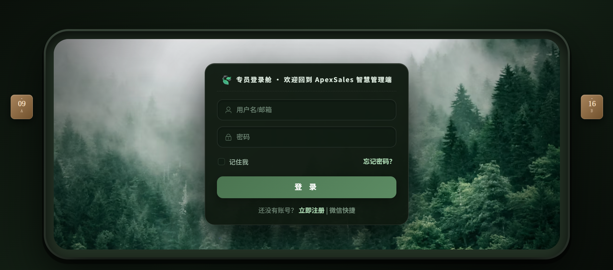
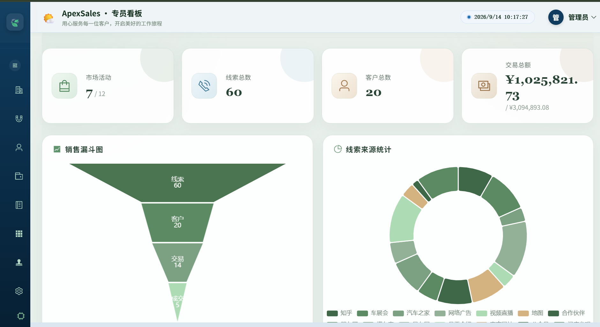
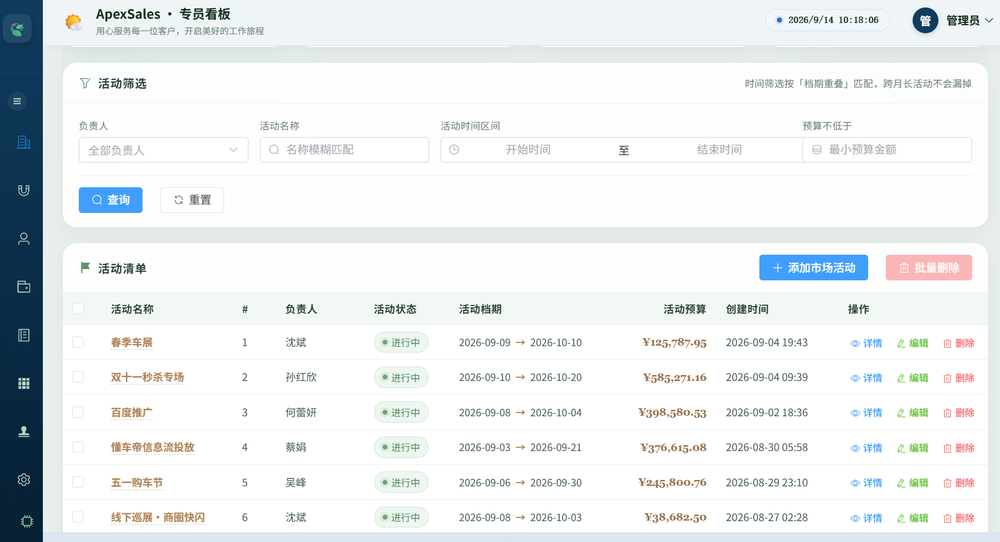
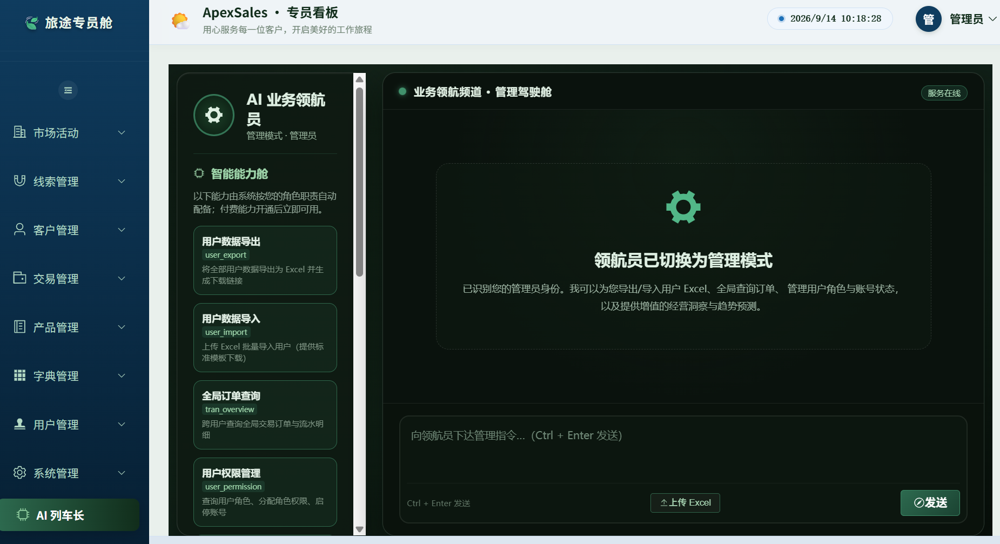
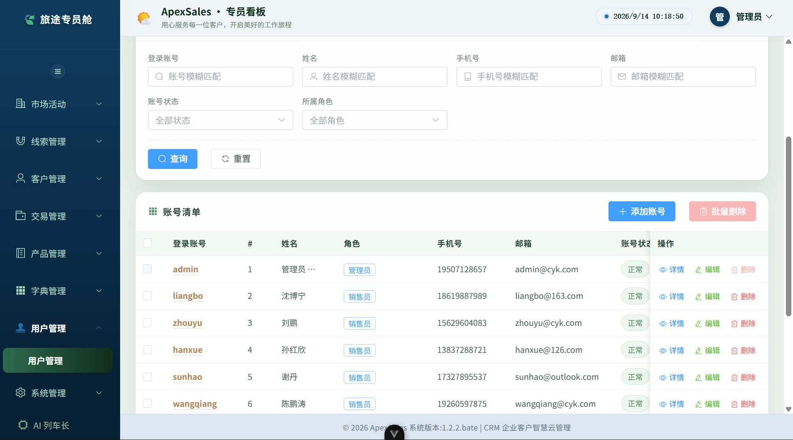
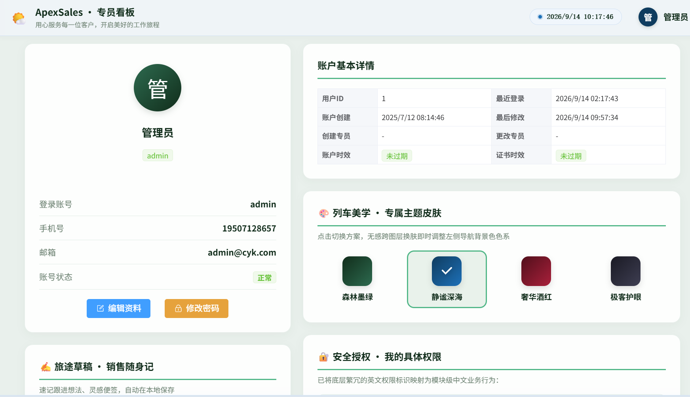

# 动力云课 DLYK —— CRM × AI 业务智能体

一套前后端分离的销售 CRM 系统，覆盖「线索 → 客户 → 交易」的完整销售流程，并集成了一个基于 LangChain4j 的**角色感知 AI 业务智能体**。



---

## 一、项目简介

销售团队的日常事务较为琐碎：哪些线索需要跟进、客户推进到哪个阶段、本月业绩趋势如何。DLYK 将这套流程数字化，并在系统内挂载了一个能够**操作真实业务数据**（而非仅做问答）的 AI 助手——它能够识别当前用户的角色，按角色开放不同的能力，并对增值能力提供付费开通机制。

核心业务链路：

```
线索（Clue）
  └──→ 转化为 客户（Customer）
            └──→ 关联 交易（Tran）
                      └──→ 阶段推进（初步接触 → 需求分析 → 报价 → 谈判 → 成交）
```


---

## 二、核心功能

- **认证与权限**：JWT 登录、记住我、免登录；操作级权限控制（后端 `@PreAuthorize` + 前端 `v-hasPermission` 指令）；单设备登录互斥；登录失败 5 次锁定 30 分钟；用户注册与找回密码。
- **数据看板**：销售漏斗图、线索来源饼图、月度趋势折线图（ECharts）。
- **线索管理**：CRUD、Excel 批量导入/导出、多条件筛选、跟进记录。
- **客户管理**：线索转化、客户列表、关联交易记录、批量导出。
- **交易管理**：CRUD、阶段推进/回退、阶段历史时间轴、跟踪记录。
- **营销活动 / 产品 / 字典**：活动备注、产品上下架、字典类型与字典值双页管理。
- **AI 业务智能体**：按角色（普通用户 / 管理员）提供差异化能力，含免费能力与付费增值能力，支持文件导入导出。
- **系统配置 / 个人中心**：系统信息编辑、开关控制、密码修改、权限查看。

---

## 三、功能演示

### 数据看板

首页汇总销售漏斗、线索来源分布与月度成交趋势，一屏掌握团队业绩全貌。



### 市场活动

营销活动的创建、备注与状态管理，可按时间、预算、负责人多条件筛选。



### AI 列车长（管理员视图）

管理员身份的 AI 助手，挂载用户管理、数据导出、批量导入、系统巡检等管理类工具；付费增值能力在工具层统一拦截。



### 用户管理

用户列表、角色分配、账号启停用与操作级权限控制，支持单设备登录互斥。



### 个人中心

个人信息维护、密码修改与当前账号权限查看。



---

## 四、技术栈

| 层 | 技术 |
|----|------|
| 前端 | Vue 3.5（Composition API）· Vue Router 5 · Element Plus 2 · Axios · ECharts 6 · Vite 7 |
| 后端 | Spring Boot 3.5 · Spring Security · MyBatis · PageHelper |
| AI | LangChain4j 1.1.0（OpenAI 兼容协议）· Reactor `Flux` SSE 流式输出 |
| 数据 | MySQL 8 · Redis（Token / 缓存 / 原子序列） |
| 其他 | EasyExcel（导入导出）· java-jwt · 定时任务（缓存刷新 / 对账） |

> 说明：`server/pom.xml` 中仍保留 `spring-ai-openai-spring-boot-starter` 与 DashScope 两个依赖，但当前业务代码**未使用**它们，AI 链路完全基于 LangChain4j 实现。

---

## 五、技术亮点

### 1. AI 智能体 · 角色感知与工具隔离

- **角色判定权威化**：每次对话实时查库判定当前用户角色，不依赖前端传参或登录时的 JWT 快照。
- **工具包物理隔离**：普通用户与管理员分别挂载不同的工具集，管理类工具在普通用户的会话中不注册，从根源上杜绝越权调用。
- **跨线程上下文**：工具调用发生在异步回调线程，通过不可变快照对象传递登录身份，规避 `ThreadLocal` 丢失问题。
- **SSE 流式对话**：基于 Reactor `Flux.merge` 合并模型 token 流与工具事件流，结构化事件（付费拦截、文件就绪）直接推送前端。

### 2. 增值付费体系

- **订单状态机**：`待支付 → 已支付 / 已取消` 单向推进，通过 SQL 乐观锁保证并发下无重复入账。
- **付费墙下沉至工具层**：付费校验在工具执行层统一拦截，不依赖模型自觉。
- **缓存一致性**：以数据库为唯一事实来源，Redis 作为加速层，通过「事务提交后写缓存 → 读路径回源 → 周期对账」保证最终一致。

### 3. 安全加固

- **操作级越权防护**：逐接口补齐 `@PreAuthorize` 权限校验，并对齐前端权限指令。
- **SQL 注入防御**：对动态过滤字段采用「参数绑定层拒收 + 切面兜底」双层防护。
- **凭证安全**：JWT 签发前对用户对象脱敏，避免密码哈希进入 token payload。

### 4. 并发与一致性

- **流水号生成**：交易流水号改用 Redis 原子自增，规避 `selectMax + 1` 的并发重号问题，并在 Redis 故障时降级回数据库。
- **线程安全**：共享内存缓存使用 `ConcurrentHashMap`，避免定时任务与请求线程并发读写问题。
- **事务边界**：多步写操作（交易增删、阶段变更、线索删除等）补齐事务控制。

---

## 六、系统架构

```
Vue 3 SPA
   │  Axios（JWT 拦截器 · 权限缓存 · 异地踢下线处理）
   ▼
Controller（web）── 参数绑定安全加固
   ▼
Manager（业务编排：线索转客户、统计分析）
   ▼
Service（核心业务逻辑 + @Transactional）
   ▼
Mapper（MyBatis · XML 动态 SQL）
   ▼
MySQL（持久化）  +  Redis（Token / 缓存 / 原子序列）
```

AI 链路：`AiAgentController(SSE)` → `AiAssistantServiceImpl`（角色编排）→ LangChain4j Agent（按角色挂载工具包）→ 大模型。

---

## 七、项目结构

```
dlyk/
├── front/                          # Vue 3 前端
│   └── src/
│       ├── http/                   # Axios 封装 + JWT 拦截器 + SSE 客户端
│       ├── router/                 # 路由配置（含登录守卫）
│       ├── util/                   # 工具函数（Token 管理、权限缓存）
│       └── views/                  # 页面组件
│           ├── activity/  ai/  auth/  clue/  customer/
│           ├── dashboard/ dict/ product/ system/ tran/  user/
├── server/                         # Spring Boot 后端
│   ├── db/                         # 数据库脚本（结构 / 数据分离）
│   └── src/main/java/com/cyk/
│       ├── web/                    # Controller 层
│       ├── manager/                # 业务编排层
│       ├── service/                # 业务逻辑层（含 ai/ 智能体模块）
│       ├── mapper/                 # MyBatis 数据访问层
│       ├── model/  query/  result/ # 实体 / 查询参数 / 返回对象
│       ├── config/                 # 安全配置 / JWT 过滤器 / AI 配置
│       ├── aspect/                 # 数据权限切面
│       ├── task/                   # 定时任务（缓存刷新 / 对账）
│       ├── commons/  exception/  util/  constants/
│       └── ServerApplication.java
├── bench/                          # 高并发性能压测工具集（Python）
└── docs/                           # 设计与学习文档
```

---

## 八、快速启动

### 环境要求

- Node.js `^20.19.0 || >=22.12.0`
- Java 21
- MySQL 8.x + Redis

### 1. 初始化数据库

```bash
# 先导入表结构，再导入测试数据
mysql -uroot -p < server/db/ApexSales.sql
mysql -uroot -p < server/db/ApexSales_data.sql
```

> 默认测试账号：`admin / 123456`

### 2. 配置环境变量

复制 `.env.example` 为 `.env` 并填写真实值。`DB_PASSWORD`、`REDIS_PASSWORD`、`JWT_SECRET` 缺失时后端会 fail-fast 拒绝启动。

### 3. 启动后端

```bash
cd server
mvn spring-boot:run        # 默认端口 8089
```

### 4. 启动前端

```bash
cd front
npm install
npm run dev                # 默认端口 5173
```

---
